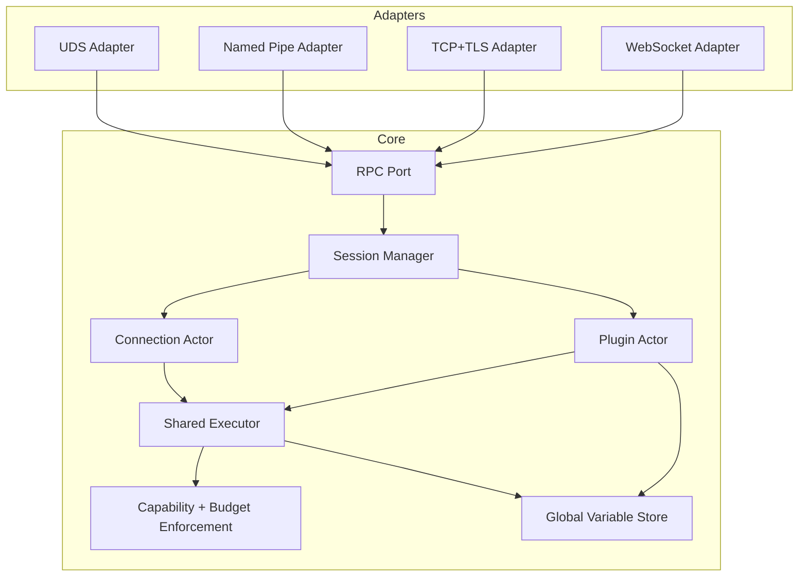
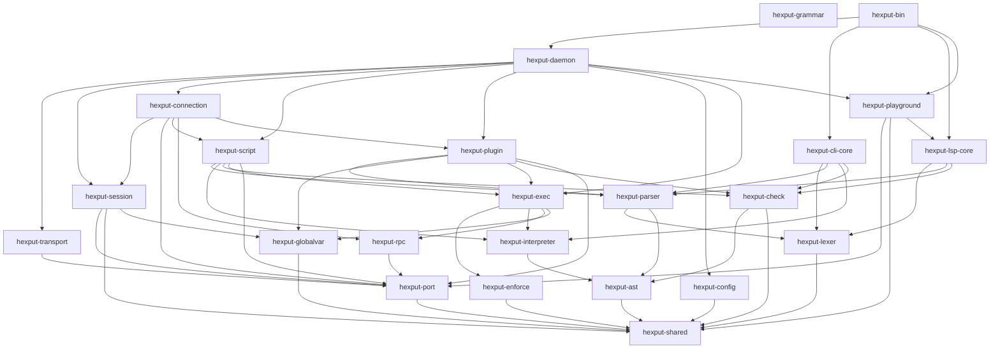
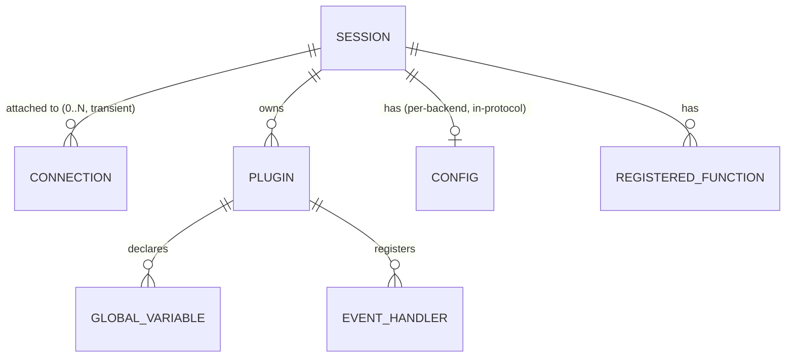

# Architecture Spine — Hexput v2

## Design Paradigm

**Hexagonal (Ports & Adapters)** at the transport boundary, wrapping an **Actor model** runtime core.

- `hexput-transport` — one adapter per Transport (UDS, Named Pipe, TCP+TLS, WebSocket), each implementing a single internal `Port` interface. No transport-specific behavior crosses into the core.
- `hexput-session`, `hexput-connection`, `hexput-plugin` — the actor layer: a `Session` (durable, Client-ID-keyed) owns a transient `Connection` actor and zero or more `Plugin` actors. Ownership here is lifecycle ownership, not a per-operation consistency boundary: `Session` creates and tears down `Plugin`s (AD-4's `teardown` contract), but a `Plugin` — together with its Global Variable store — is its own consistency boundary for event dispatch, since `hexput-session` never mediates a single Event invocation.
- `hexput-exec`, `hexput-enforce` — the shared execution core every actor's work funnels through; this is where Capability and Resource Budget rules apply, once, for every mode.

## Invariants & Rules



Dependency direction: Adapters depend on the Core `Port`; the Core never imports or branches on a specific Adapter. Nothing depends back on Adapters.

### AD-1 — Transport-agnostic core [ADOPTED]

- **Binds:** FR-9, FR-11, all Transports
- **Prevents:** transport-specific behavior leaking into Session/execution semantics; adapters and core drifting on per-transport protocol behavior; health/metrics (FR-11) becoming a fifth, structurally separate listener
- **Rule:** every Transport is an adapter implementing one internal `Port` interface; the Core crate graph never imports or branches on a specific transport type — enforced by which crates list `hexput-transport` as a dependency (only `hexput-daemon` does). Health/metrics (FR-11) is served through that same `Port`, exempted from the init-handshake gate (FR-1) rather than given its own listener.

### AD-2 — Session outlives Connection, and may have several at once [ADOPTED]

- **Binds:** FR-1, FR-2, FR-3, FR-13, FR-21, FR-24
- **Prevents:** Plugin/Config/Registered-Function state being coupled to a single live socket, breaking reconnect (FR-2) and Plugin persistence (FR-21); a Session's connection cardinality being read differently by independently-built units
- **Rule:** `Session` is a distinct, owned entity keyed by Client ID, with a TTL sourced from System Config (AD-5). A Session may have zero or more concurrently attached `Connection` actors (FR-2) — never exactly one. Each `Connection` is attached to at most one `Session` at a time and holds no state that outlives it. Requests and their responses correlate to the specific `Connection` that issued them; there is no cross-Connection broadcast of results — Connections are isolated from each other even when they share a Session. The Session's TTL clock (FR-21, FR-24) only starts once the last attached Connection drops; while at least one Connection is attached, the Session is actively alive with no TTL countdown running. Session-owned state (Plugins, Config, Global Variables) is shared and consistent across every attached Connection. The reconnect credential (FR-13) is validated once, in `hexput-session`, before a reconnect request is accepted — every Transport adapter forwards the credential unchanged through the Port; no adapter performs its own validation, and no transport crate depends on `hexput-session` in a way that would let it try.

### AD-3 — One shared Executor enforces Capability + Resource Budget for every execution path, for its full duration [ADOPTED]

- **Binds:** FR-6, FR-7, FR-8, FR-19, FR-25
- **Prevents:** Direct Execution, Cached Execution, and Plugin Event handlers implementing capability/budget checks independently and drifting apart; async handler work (AD-6) silently escaping budget accounting once dispatch returns
- **Rule:** all three execution paths call into one `Executor` entry point; no path may reach a Registered Function or consume Resource Budget outside it. For any execution that continues past its dispatching call's return — every `async = true` Plugin handler (AD-6) — `Executor` hands the spawned task a live budget-accounting handle, not a closed one; every budget-relevant operation that task performs afterward, including Global Variable writes counted as side effects (AD-4), charges through that same handle. `hexput-globalvar` has no dependency on `hexput-enforce` or `hexput-rpc` at all — a second path into either is not merely discouraged, it does not compile. Global Variable access itself is intrinsic language state, not a Registered Function — exempt from FR-6/FR-7's capability-grant requirement, reached only through the direct `Executor`/`Plugin → GVStore` path (never through `hexput-rpc`). Both of Plugin's dispatch paths (the priority sequencing task and directly-spawned `async` handlers, AD-4) invoke the same single handler-invocation function in `hexput-exec` — capability checks, budget-handle setup, and Global Variable access all happen in that one shared function; the two paths differ only in *when* they're scheduled, never in *what* runs.

### AD-4 — Global Variable store is independent of the Plugin actor's mailbox [ADOPTED]

- **Binds:** FR-20, FR-22, FR-23, FR-25
- **Prevents:** `async` handlers (FR-23) being forced through a serialized mailbox (breaking their bypass-ordering requirement); `priority`-ordered handlers (FR-22) losing sequencing, or accidentally serializing *different* Events on the same Plugin; the store leaking on teardown; `keyed` variables (FR-25) serializing unrelated partitions
- **Rule:** a Plugin's Global Variables live in a shared concurrent per-Plugin store, independent of and reachable without the Plugin actor being alive. Locking is per-`(top-level-key, partition-key)` — for a non-`keyed` variable, partition-key is a constant, collapsing to plain per-top-level-key locking; for a `keyed` variable (FR-25), different Backend-supplied keys never contend for the same lock. A Global Variable's lock is never held across an `.await` point (e.g. a handler's mid-execution RPC call) — every read/write is a short, synchronous critical section against the store; a handler that needs the value across an await re-acquires it. The Backend-configurable "unsafe/lock-free" strategy (FR-20) is implemented entirely in safe Rust — no `unsafe` blocks — by using the store's finer-grained/optimistic access instead of the default per-key critical section; it trades logical race-safety (permits lost updates, stale reads) for latency, and is unrelated to the Security NFR's "no unsafe Rust in the parser/VM path" rule, which is about memory safety, not this concurrency-semantics choice. `hexput-globalvar` exposes `teardown(plugin_id)` as its sole store-lifecycle entry point; `hexput-session`'s TTL-expiry and explicit-unregister paths (AD-2, FR-21) are its only callers, invoked synchronously before the Plugin actor is dropped — teardown is never implied by actor `Drop`. The Plugin actor owns event routing and ordering *metadata* only (which handler runs at which priority) — it does not itself execute the ordered chain: `priority`-ordered dispatch for one Event is a per-(Plugin, Event) sequencing task spawned independently of the actor's mailbox, so an in-progress priority chain for one Event never blocks a different Event arriving concurrently for the same Plugin. Both that sequencing task and directly-spawned `async` handlers read/write the same Global Variable store.

### AD-5 — Per-backend Config and System Config are separate, non-overlapping surfaces [ADOPTED]

- **Binds:** FR-1, FR-3, FR-24
- **Prevents:** daemon operational settings (bind addresses, TLS paths, log level, Session TTL) being conflated with backend-supplied execution policy, or either surface silently absorbing the other's responsibility; a runtime Config update (FR-3) silently not reaching already-registered Plugins
- **Rule:** System Config (file-based) is the only source of the daemon's own operational settings. Per-backend Config never touches disk and never configures the daemon itself. `hexput-session` holds the single mutable, live copy of a Session's per-backend Config; `hexput-plugin`, `hexput-script`, and `hexput-exec` read through that copy on every dispatch — none of them snapshot or cache it at registration time — so an FR-3 runtime update is visible to Plugin Event dispatch exactly as it is to Direct/Cached Execution, with no separate propagation path to keep in sync.

### AD-6 — Non-blocking dispatch is structural, not incidental [ADOPTED]

- **Binds:** FR-16
- **Prevents:** a slow execution on one connection or Plugin stalling unrelated work — the head-of-line blocking FR-16 explicitly forbids
- **Rule:** every execution (Direct, Cached, Plugin handler) dispatches as an independent async task on the shared runtime. The only permitted serialization is a Plugin's own opted-in `priority` ordering (FR-22) among its own handlers for one Event — never across connections, Plugins, or Events (AD-4's per-(Plugin, Event) sequencing task is what makes this hold in practice).

### AD-7 — System Config discovery is one deployment-agnostic precedence, packaging doesn't change it [ADOPTED]

- **Binds:** FR-24
- **Prevents:** a systemd build and a Docker build independently inventing different config-discovery logic (different default paths, different override mechanisms) that silently diverge
- **Rule:** `hexput-config` resolves the System Config file's location via one fixed precedence regardless of packaging — explicit CLI flag, then environment variable, then a fixed default OS path. systemd units and Docker images both just set the environment variable or bind-mount the default path; neither changes `hexput-config`'s resolution logic.

### AD-8 — One check pass, one invocation point per submission path [ADOPTED]

- **Binds:** FR-26, FR-3, FR-5, FR-6
- **Prevents:** Direct submission, Cached registration, and Plugin registration each growing their own partial checker and disagreeing about what is a finding; the check drifting into a second, unenforced capability surface; the hot path paying for a check it already passed
- **Rule:** `hexput-check` exposes a single pure entry point taking a parsed AST plus what the environment provides — the callable-name set and the Script's starting-variable names — and the active policy, and returning findings — it never executes a script, never reaches `hexput-rpc` or `hexput-enforce`, and holds no state between calls. It is invoked from exactly one place per submission path: `hexput-script` on Direct Execution and on `CodeRegister` (never again on `CachedExecutionStart` — a registered script is checked once, at registration), and `hexput-plugin` at Plugin registration. The mode (`off`/`warn`/`error`) is read from the `hexput-session` live Config on every submission, never snapshotted (AD-5). Findings reuse the error shape defined once in `hexput-port` (Consistency Conventions), so the daemon response, the CLI, and the language server render them identically. The check is advisory by construction: it never grants, denies, or substitutes for a capability check or a budget charge — those remain `hexput-enforce`'s alone, reached only through the `Executor` (AD-3), and a script passing the check is not thereby authorized for anything.

## Consistency Conventions

| Concern | Convention |
| --- | --- |
| Naming (entities, files, interfaces, events) | Code identifiers match PRD §3 Glossary terms verbatim (`Session`, `Plugin`, `GlobalVariable`, `Capability`, ...) — no synonyms |
| Data & formats (ids, dates, error shapes, envelopes) | MessagePack (`rmp-serde`/`serde`) wire envelope for all Transports; Client ID and error shapes defined once in `hexput-port`, reused by every adapter |
| State & cross-cutting (mutation, errors, logging, config, auth) | All state mutation with security/budget consequences flows through `exec`/`enforce` (AD-3); structured logging via `tracing`, every entry tagged with Client ID (PRD FR-12); config split per AD-5 |
| Locking discipline | No lock (Global Variable or otherwise) is ever held across an `.await` point — critical sections stay short and synchronous; re-acquire after suspension instead |

## Stack

| Name | Version |
| --- | --- |
| Rust | 1.98.1 (2024 edition) |
| tokio | 1.53.1 |
| tokio-tungstenite (`handshake` only; no default features — the TLS is our own tokio-rustls) | 0.30.0 |
| futures-util (`sink`, `std`; no default features) | 0.3.34 |
| rustls (`ring`, `std`, `tls12`; no default features — the `ring` crypto provider, never `aws-lc-rs`) | 0.23.45 |
| tokio-rustls (`ring`, `tls12`; no default features) | 0.26.6 |
| serde | 1.0.229 |
| rmp-serde | 1.3.1 |
| rmpv (`with-serde`) | 1.3.1 |
| dashmap | 6.2.1 |
| getrandom | 0.4.3 |
| ring (default features; `hexput-session`'s reconnect credential) | 0.17.14 |
| moka (`sync`) | 0.12.16 |
| criterion | 0.8.2 |
| rhai (bench comparator, hexput-tests dev-only) | 1.26.1 |
| tracing | 0.1.44 |
| clap (`derive`) | 4.6.7 |
| toml (`std`, `parse`, `serde`; no default features) | 1.1.6 |
| tracing-subscriber (`fmt`, `std`, `json`; no default features) | 0.3.23 |
| serde_json (tests only) | 1.0.151 |

**[Amended 2026-09-22, Epic 1 Story 1.9 decision 1]** `clap` is added: `hexput-cli-core` needs an argument parser for the eval command, and Story 1.10's check command and the daemon's own `--config` flag (AD-7) then inherit the same one rather than each hand-rolling a parser. It is pinned here and in `[workspace.dependencies]` like every other row. Adding it to this table is deliberate: "nothing not listed is permitted" governs *crate edges* in the dependency graph below, while the Stack table is the one place a third-party version lives.

**[Amended 2026-09-23, Epic 2 Story 2.1 decision 1]** `toml` and `tracing-subscriber` are added. `hexput-config` parses the System Config file as TOML through `serde`, with the parser's serializer (`display`) left out because System Config has no write API. `hexput-daemon` emits its startup log — the resolved System Config path and the AD-7 source that supplied it — through a plain `tracing-subscriber` `fmt` subscriber filtered at the file's `log_level`; structured JSON output joins as a feature of the same pin with Story 2.8. From this story on, `[workspace.dependencies]` pins each crate's **feature set** alongside its version (`tokio`'s `rt-multi-thread` + `signal`, `serde`'s `derive`), so a member writes `workspace = true` and nothing else and two crates cannot diverge on what a dependency provides.

**[Amended 2026-09-23, Epic 2 Story 2.2 decision 5]** `rmpv` is added, with `with-serde`. `hexput-port` decodes a frame in two phases — bytes to an untyped MessagePack value through `rmp-serde` (whose nesting-depth limit bounds recursion), then the envelope map validated by hand so every failure gets its exact `protocol.*` code and the correlation id is recovered whenever it is readable. `rmpv::Value` is that untyped value and the Port's payload type; later stories convert a payload to its typed struct with `rmpv::ext::from_value`. It is the same project and release line as the already-pinned `rmp-serde`.

**[Amended 2026-09-23, Epic 2 Stories 2.4 + 2.5]** `getrandom` is added, with no features. `hexput-session` draws each Client ID's 128 bits from the OS CSPRNG through `getrandom::fill`, so a Client ID is unguessable rather than merely unique; OQ-2's reconnect secret (Epic 5) will draw from the same source rather than add a second one. A Daemon that cannot read the CSPRNG issues no Client ID at all. The same stories put the already-pinned `dashmap` to its first use: the Session registry, keyed by Client ID.

**[Amended 2026-09-23, Epic 2 Story 2.8]** `tracing-subscriber` gains its `json` feature, on the same 0.3.23 pin. System Config's `log_format = "json"` makes `hexput-daemon` write one JSON object per event, with the fields of every enclosing span — a connection's `connection` and `client_id`, a request's `id` — as JSON fields; plain text stays the default. The feature brings `serde_json` and `tracing-serde` in transitively; `serde_json` is also pinned — here and in `[workspace.dependencies]` — as a test-only dependency of `hexput-tests`, which parses those lines; no production crate depends on it directly. No crate edge changes.

**[Amended 2026-10-22, Epic 4 Story 4.5]** `rhai` is added at 1.26.1 (default features), the latest release out for more than a month, as the like-for-like comparator SM-1 and NFR3 name. It is a dev-dependency of `hexput-tests` alone — the `cache` bench runs the same rule on a bench-local Rhai server over the same UDS framing and Backend client, and on Rhai's engine in-process — so no production crate can reach it, no crate edge changes, and `check-crate-graph.py` (which governs normal dependencies) is unchanged. The budget-enforcement overhead line is measured in-process (the interpreter with and without the Executor's synchronous enforcement) because the Daemon has no budget off switch and none is added: the UDS headline figures always run with the full default Resource Budget (SM-C1/SM-C2).

**[Amended 2026-10-22, Epic 5 Story 5.1]** `tokio-rustls` is added at 0.26.6, and `rustls` takes the `ring` crypto provider (features `ring`, `std`, `tls12`, no defaults), resolved at exactly 0.23.45; `aws-lc-rs` never appears in `Cargo.lock` — `ring` is a far smaller build (no cmake, no large C library) and Hexput has no FIPS ambition. Both are normal dependencies of `hexput-transport` only (and dev-dependencies of `hexput-tests`, for its TLS client); no workspace crate edge changes. The TCP+TLS adapter (`hexput_transport::tcp_tls`) fixes the TLS policy: TLS is mandatory on every TCP connection with no option to disable it; the handshake runs in the per-connection task the Daemon spawns, never in the accept loop, bounded at 10 s (`HANDSHAKE_TIMEOUT`); rustls's safe default protocol versions (TLS 1.2 + 1.3); no client authentication — a Backend's credential is the init/reconnect protocol (OQ-2, Story 5.5), the same on every transport (AD-2) — and no ALPN. The certificate chain and key are read as PEM through `rustls-pki-types`' `PemObject` (no `rustls-pemfile`), once at startup; a restart is the reload. System Config's `[transport.tcp] bind` may name an IP alone, which listens on the default port 7476 (FR-29). UDS and TCP+TLS share one length-prefixed framing implementation inside `hexput-transport`.

**[Amended 2026-10-22, Epic 5 Story 5.2]** `tokio-tungstenite` takes the `handshake` feature alone (no default features): the server upgrade runs over our own tokio-rustls stream, so neither tungstenite's TLS features nor its `connect` client are built. `futures-util` is added at 0.3.34 (`sink`, `std`; no defaults; the version already in `Cargo.lock`) for the WebSocket stream's split halves. Both are normal dependencies of `hexput-transport` only (and dev-dependencies of `hexput-tests`, for its WSS client); no workspace crate edge changes. The WebSocket adapter (`hexput_transport::websocket`) fixes the policy: one binary WebSocket message carries exactly one MessagePack envelope, with no length prefix (Story 2.2's recorded framing), bounded by `MAX_FRAME_LEN` as a message and as a frame; a text message is `protocol.malformed_frame` (not fatal). TLS is mandatory on every WebSocket connection, exactly as on TCP — there is no `ws://` mode — so Story 2.1's optional WebSocket TLS is withdrawn: `[transport.websocket]` requires `tls_cert` and `tls_key`. Its `bind` may name an IP alone, which listens on the default port 7478 (FR-29). The TLS handshake and the HTTP upgrade both run in the per-connection task, never in the accept loop, under one 10 s bound (`HANDSHAKE_TIMEOUT`). Any request path is accepted; no subprotocol is negotiated, no `Origin` is checked (a Backend authenticates in-band through init/reconnect, never with cookies) and no extension is offered. The Daemon sends no Close frame of its own (the `Port` has no close hook); a peer's Close is answered.

**[Amended 2026-10-22, Epic 5 Story 5.3]** The Windows Named Pipe adapter (`hexput_transport::named_pipe`, `cfg(windows)`) is the Windows-native local transport, over tokio's `NamedPipeServer` — the `net` feature already pinned, so no new dependency or feature. Its policy is fixed: byte mode with the shared 4-byte length-prefixed framing (one framing for every byte stream; no message-mode pipe); the first instance is created with `first_pipe_instance(true)`, so a name another process already serves (another Daemon, or a squatter) fails startup as "pipe already in use" rather than being shared; remote (SMB) clients are rejected, so the pipe is local only and, like UDS, carries no TLS; Windows' default security descriptor (no DACL or `mode` option, no instance limit), under which only the Daemon's account and administrators can open the pipe read/write. Authentication stays the in-band init/reconnect (AD-2). System Config gains `[transport.named_pipe] path` (`\\.\pipe\<name>`, at most 256 characters, no `\` in the name), parsed and validated on every platform. The platform rule: `[transport.uds]` is served only on Unix and `[transport.named_pipe]` only on Windows, TCP and WebSocket everywhere; a configured section the platform cannot serve is skipped with a `warn` naming it, so one System Config can serve hosts of both kinds, and only a System Config with nothing servable on the platform fails to start. `hexput-daemon`'s serving path is platform-independent apart from its one local-transport module per platform. A `windows` CI job (`windows-latest`) lints the workspace and runs the Named Pipe tests; `scripts/check-windows.sh` is the local compile-only cross-check. No crate edge changes.

**[Amended 2026-10-22, Epic 5 Story 5.4]** FR-9 (the transport is a latency and topology choice, never a semantic one) is proven by one shared **conformance suite** in `hexput-tests` (`tests/daemon/conformance.rs`, part of the `daemon` test target): a list of cases, end to end against the real Daemon, written against a transport-neutral `Client` (send an envelope, send one raw message body in the transport's own framing, read the next reply) and run unchanged over every transport the platform serves — UDS, TCP+TLS and WebSocket on Unix, the Named Pipe, TCP+TLS and WebSocket on Windows (the `windows` CI job runs it). The cases cover init, the init gate, Direct and Cached Execution, script errors, host calls, capability denial (unregistered and handler-refused), the counted budget dimensions, `ConfigUpdate`, invalid payloads and the protocol refusals; each asserts its own replies, a sentinel request after each case proves nothing further arrived, and the normalized transcripts (Client ID, Script handle and a generated Reference ID's nonce replaced, nothing else) of every platform transport must be byte-identical. **Extension rule:** a new adapter adds one `Transport` implementation (its name, its System Config section, how a client connects) and one `transports!` line, which is both its test and its place in the transcript comparison; no case changes, and no case may name a transport (a test pins that). **The one known difference** stays outside the suite: a WebSocket ends both directions together, so a reply still owed after the Backend's Close frame (or a TCP end after a TLS `close_notify`) cannot be sent where a byte stream still writes it (Story 5.2, recorded in deferred work); no case half-closes a connection with work in flight. AD-1 gains a second guard beside `SOLE_DEPENDENTS`' "only `hexput-daemon` depends on `hexput-transport`": `scripts/check-crate-graph.py`'s **transport-name guard** (`TRANSPORT_NAMES`) fails, naming the crate and file:line, when any `*.rs` file (comments and docs included) or `Cargo.toml` of a production crate names a transport (`uds`, `tcp`, `tls`, `wss` also as one part of a snake_case or CamelCase identifier such as `tcp_tls` or `TcpTlsPort`; WebSocket, Named Pipe, Unix domain/socket/stream/listener/datagram, `TcpStream`/`TcpListener` with or without a space, `_` or `-` inside; `rustls`, `tungstenite`, `ws://`/`wss://`), exempting only `hexput-transport` (the adapters), `hexput-daemon` (the wiring root) and `hexput-config` (System Config owns the `[transport.*]` sections, AD-7), plus the test crate. No crate edge changes.

**[Amended 2026-10-22, Epic 5 Story 5.5]** The reconnect credential (FR-13, OQ-2) is issued at every successful `Init` and defined in `hexput-session` alone. `Sessions::create` draws a 256-bit `ReconnectSecret` from the OS CSPRNG through `getrandom::fill` — the Client IDs' one source; a CSPRNG failure panics exactly as Client ID issue does, so no Session and no secret exist — and the `Init` reply is `Result {client_id, reconnect_secret}`, in that order, the secret spelled as 64 lowercase hex characters (mirroring the Client ID's hex text: safe in any SDK and in a Backend's JSON logs, where MessagePack binary would complicate SDKs for nothing). The secret is sent this once and in no later response; it is never stored, never logged, never in a span or event field, and its type has a redacting `Debug`, no `Display`, no `Clone`/`Copy` and no serde — its text comes only from `to_hex`, and a presented one is read back only by `from_hex` (exactly 64 lowercase hex). The Session keeps a per-Session 32-byte random salt and `HMAC-SHA256(key = salt, message = secret)`; the secret carries 256 bits of entropy, so a slow password-hashing KDF would add nothing. `Sessions::verify_reconnect(client_id, &secret)` checks a presented secret with `ring::hmac::verify` — the constant-time comparison Story 5.6 requires, so no `subtle` — and an unknown Client ID is checked against a fixed dummy credential, so one HMAC verify runs either way and gives the same `false` (the registry lookup itself is not constant time; Story 5.6 owns any limit on reconnect attempts); it lands now so the stored hash is testable through the public API, and Story 5.6 builds verify-and-attach and the reconnect-denied error on it. There is no rotation: the secret lives as long as the Session. `ring` is added at 0.17.14 with default features, a normal dependency of `hexput-session` only — exactly the build rustls's `ring` provider already unifies, so nothing new is compiled or downloaded; no `subtle` (ring's verify already compares in constant time) and no `sha2` (ring's HMAC covers it). `zeroize` is left out by decision, not for build cost (rustls already builds it): the secret and its hex text are dropped, not wiped, after the reply is sent — memory hygiene is not part of FR-13's threat model, which is a leaked Client ID, not a read of Daemon memory. No crate edge changed. Adapters and `hexput-connection` only carry the string; nothing validates it anywhere else (AD-1, AD-2), and the conformance suite normalizes `reconnect_secret` like the Client ID, so transcripts stay byte-identical across transports.

**[Amended 2026-10-22, Epic 5 Story 5.6]** Reconnect (FR-2, FR-13) is one wire request, the same on every transport: `Reconnect` (`MessageType::Reconnect`, after `Init`), the alternative to `Init` on a connection not yet attached, bypassing the init gate like it. Its payload is exactly `{client_id, reconnect_secret}` — the Client ID as 32 and the secret as 64 lowercase hex characters — decoded by hand in `hexput-session` (`ReconnectRequest::from_value`) **before any registry lookup**, so whether a payload is refused never depends on whether a Session exists. A malformed payload (not a map, a missing — absent or nil, both named together — repeated or unknown key, a non-string or wrongly spelled value) is `protocol.invalid_payload`, and no message echoes a presented Client ID or secret (an unknown key is named only when it is a string of at most 16 characters, so a credential sent as a key is not echoed): a syntactically impossible credential can never match, so saying so leaks nothing. **A carried Config is rejected, not ignored:** `config` or `registrations` beside the credential is `protocol.invalid_payload` naming the key and saying the stored Config and registrations are resumed (a `ConfigUpdate` after reconnecting changes the Config) — ignoring it would let a Backend believe a policy is in force that is not, the rule `Init` already applies to unknown keys. A well-formed credential goes to `Sessions::reconnect(client_id, &secret, connection)`, the one verification (AD-2): `Credential::verify` (`ring::hmac::verify`, constant time) and the attachment happen under the **same shard lock**, so a racing detach of the Session's last Connection either tears it down first (denied) or sees the new attachment; an unknown or torn-down Client ID runs the same dummy verify as `verify_reconnect` — one HMAC verify per attempt. What is identical is the outcome and the reply, not the timing: a live Client ID takes its shard's write lock and may wait on it, which is no oracle worth having against 128 random bits. Every miss is `protocol.reconnect_denied` (new, last in `ProtocolCode::ALL`, not fatal) with the one fixed message `no Session matches this Client ID and reconnect secret`, so a wrong secret and an unknown Client ID are byte-identical apart from the echoed id, and the connection stays open and unattached (it may retry or `Init`). Success answers `Result {client_id}` — exactly that key, never the secret, which is sent only at `Init` — and the Connection then serves exactly as if it had sent the `Init`, against the Session's stored Config, registrations and AST Cache entries (the cache is not opened again: a live Session's Client ID already is); the connection span is replaced with one carrying the Client ID, "reconnect completed; attached to the Session" its first event, and the presented secret is never logged and is dropped after verification. An `Init` or `Reconnect` on an attached connection is `protocol.already_initialized`, with nothing decoded or verified. **No attempt limit** and no closing after denials: a 256-bit secret makes guessing infeasible and the denial is no oracle; the uncapped-connection and pre-init-deadline items in deferred work cover the remaining resource exposure. Until Story 5.8 delays teardown behind the TTL, detaching a Session's last Connection still tears it down at once, so a reconnect only reaches a Session another Connection still holds *(superseded by the Story 5.8 amendment below)*; 5.8 changes the teardown path, not this one. No crate edge, dependency or transport-specific code changed; the conformance suite's `reconnect` case runs it over every platform transport.

**[Amended 2026-10-22, Epic 5 Story 5.7]** Several Connections under one Client ID (FR-2, AD-2, AD-5) need no new machinery, only a stated contract. **Cardinality:** any number of Connections may be attached to one Session at once — the first by `Init`, each further one by `Reconnect` — with **no cap** in this story (the uncapped-connection item in deferred work covers the resource exposure), and they may arrive over different transports; the Session never knows which. **Per-Connection, never shared:** request ids, replies, and the `Call`/`Authorize` id counter and pending table (`hexput_rpc::Calls`, one per `serve`). The same request id on two Connections is two independent requests. A `Call` or `Authorize` for an execution is written only to the Connection that started it, and only that Connection's `Result`/`Error` completes it. **A reply on the wrong Connection is not routed across:** correlation ids collide across Connections by design, so routing by id across a Session would let one Connection complete another's call; a `Result`/`Error` naming an id with nothing pending on *its own* Connection is answered there `protocol.unexpected_message` (nil id, as before) and the other Connection's call stays pending. **Per-Session, shared and read afresh at dispatch:** the Config (a `ConfigUpdate` from any attached Connection), the registrations and the AST Cache entries (`CodeRegister` on one, `CachedExecutionStart`/`CodeUnregister` on any). **No broadcast:** no Connection is told of another's change — a `ConfigUpdate`'s `Result {}` goes to the updater alone — and nothing orders requests across Connections (AD-6). **Registration reading (decided unattended):** function registrations are made only at `Init` (FR-1); no planning artifact defines a runtime function-registration request and none is invented here, so "a registration made through one Connection is visible to all" is met by the `Init` registrations serving every reconnected Connection and by `CodeRegister`/`CodeUnregister`, the one registration a Connection can make after attaching; a later epic that adds runtime registration stores it in Session state and inherits this. A Connection leaving (clean close, lost stream, fatal frame) detaches it alone; the others' in-flight executions and the Session continue, and the Session is torn down only when the last one detaches (Story 5.8 delays that behind the TTL). The conformance suite's `several_connections` case runs this over every platform transport, and `one_session_spans_every_transport_this_platform_serves` attaches one Connection per served transport to one Session at once. No wire message, field, error code, crate edge or dependency changed.

**[Amended 2026-10-22, Epic 5 Story 5.8]** A Session outlives its last Connection by a TTL (FR-2, FR-21, FR-24, AD-2, AD-4). **Start and stop:** the countdown starts only when the *last* Connection detaches — while any Connection is attached none runs — and a valid `Reconnect` (or the unverified `attach`) before it elapses stops it in the same shard lock as the credential verify, leaving the Session's Config, registrations, AST Cache entries and reconnect secret untouched; a wrong secret leaves it running. **Duration:** System Config's `session_ttl_secs` (already validated, at least 1 s, default 300) — never set per Session by the Backend. **Mechanism (decided unattended):** `hexput-session` stays synchronous and gains no dependency, so it owns *what* expires and `hexput-connection` owns *when*. `Sessions::with_ttl(Duration)` (chaining with `with_teardown` in either order) sets the registry's TTL; `Sessions::detach` returns `Option<Expiry>` — `Some` only for the last detach on a registry with a TTL, which marks the Session expiring under a fresh countdown generation from a per-registry counter, the `Expiry` carrying the Client ID, the TTL and that private generation (constructible only by `detach`). `Sessions::expire(&Expiry)` tears down only through `remove_if` when the Session is still unattached *and* still under that generation, so an `Expiry` from an earlier orphaning — the countdown since stopped, maybe restarted — does nothing; `expire` trusts the caller's timing and guards only the countdown's identity, which keeps the registry tests deterministic. `Sessions::expiring(client_id)` reports whether a countdown runs. `serve`, the one production detach site, spawns one detached Tokio task per orphaning that sleeps the TTL and calls `expire`; it holds only an `Arc<Sessions>` and the `Expiry`, and no lock is held across its `.await`. **One teardown path:** expiry runs the same private `teardown` — Config, credential, registrations, then the hook (`AstCache::close`) — exactly once; the TTL delays that path, it adds no second one and nothing is implied by `Drop` (AD-4). **After expiry** the Session is gone from the registry, so a reconnect with its Client ID and secret is `protocol.reconnect_denied`, byte-identical to an unknown Client ID, and its cache handles are gone. **Zero TTL:** a registry without one (`Sessions::new()`, or `Duration::ZERO`) tears down at the last detach and returns no `Expiry` — the same path with no delay, the registry's default for tests; the Daemon always passes System Config's TTL, so it never does this. **No reaper** and no sweep: a countdown is one task's timer. On Daemon shutdown pending countdowns are cancelled with the runtime and the registry drops with the run; no Session is torn down one by one. Logged at `debug` in the connection span: "last connection detached; the Session expires after its TTL unless a Connection reconnects" (`ttl_secs`) and "Session expired after its TTL; torn down". This supersedes the Story 5.6 amendment's "Until Story 5.8 delays teardown behind the TTL…" sentence. No wire message, field, error code, crate edge or dependency changed.

## Structural Seed

**[Amended 2026-09-18, post-final, per user direction: "her modülü kendi crate'ine ayıralım... shared crate'in iç modül yapısı da olabildiğince parçalı olmalı... bütün crateler lib olmalı, binarylerin çıkacağı bin diye ayrı bir crate olmalı."]** What was one crate with an internal module tree is now a Cargo workspace: one crate per Structural Seed module, plus crates for the language (never named as a module above because it sits underneath `hexput-script`, `hexput-check`, and `hexput-plugin` rather than being one itself) and for developer tooling. This is not cosmetic — a crate boundary is a dependency edge Cargo enforces at compile time, where a module boundary was only convention. Several ADs below (AD-1, AD-3, AD-4, AD-5, AD-8) state a rule of the shape "only X may reach Y directly" — under the module tree that rule lived in code review; under the crate graph, the crate that must not reach Y simply does not list it as a dependency, and doing so anyway is a compile error, not a review finding.

**Every crate is a `lib` crate.** Exactly one crate in the workspace, `hexput-bin`, is allowed to produce a binary; every other crate — including `hexput-daemon` — exposes a `run()`-shaped entry point and nothing calls `std::process::exit` or owns a `fn main()`. `hexput-bin` itself stays systematically thin: one file per binary under `src/bin/`, each doing nothing but argument parsing hand-off and a call into the one library crate that actually implements that binary. No logic lives in `hexput-bin` that isn't about being an operating-system entry point.

```text
Cargo.toml                    # [workspace], members below, pinned deps hoisted to [workspace.dependencies]
crates/
  hexput-shared/               # cross-cutting types every other crate may depend on; internally split, never a grab-bag
    src/
      diagnostics.rs           # Category, Code, Diagnostic, Span — the one error/finding shape (§7 LANGUAGE-REFERENCE, hexput-port errors)
      wire.rs                  # MessagePack envelope, correlation id, message-type enum (Consistency Conventions)
      ids.rs                   # ClientId, SessionId, PluginId — newtypes, never bare strings/uuids past the boundary
      budget.rs                # the six Resource Budget dimensions (FR-8) as one enum, shared by hexput-enforce, hexput-check and metrics
      policy.rs                # the closed set of language feature toggles (FR-3) and the enabled set, shared by hexput-port, hexput-interpreter (via hexput-ast) and hexput-enforce; hexput-check adopts them in Story 3.10 [amended 2026-09-27]
      lib.rs

  # — language: no execution, no I/O, no host access —
  hexput-ast/                  # AST node types + Span — data only, no lexing/parsing/eval logic
  hexput-lexer/                # tokenizer (Epic 1 Story 1.2) — depends on hexput-shared only
  hexput-parser/                # parser (Stories 1.3-1.5) — depends on hexput-lexer, hexput-ast
  hexput-interpreter/          # tree-walking evaluator (Stories 1.6-1.7) — depends on hexput-ast only, no host reach
  hexput-check/                # static check (FR-26, AD-8) — depends on hexput-ast only; NOT hexput-interpreter, NOT hexput-rpc, NOT hexput-enforce, by construction
  hexput-cli-core/             # eval + check command logic (Stories 1.9-1.10) — depends on lexer/parser/interpreter/check

  # — daemon: one crate per Structural Seed module —
  hexput-transport/            # adapters: uds.rs, named_pipe.rs, tcp_tls.rs, websocket.rs — one Port impl each
  hexput-port/                  # wire envelope + request/response + event correlation, built on hexput-shared::wire
  hexput-session/                # Client ID -> Session, TTL (from System Config), reconnect + FR-13 protection
  hexput-connection/            # transient per-connection actor, attached to a Session
  hexput-script/                # Direct/Cached Execution: AST cache (moka), parse/interpret entry points
  hexput-plugin/                # Plugin actor: registration, event routing, priority/async dispatch (AD-4)
  hexput-globalvar/              # Global Variable store: per-Plugin concurrent map (dashmap), locking + behavior strategies
  hexput-exec/                   # the one shared Executor all three modes funnel through (AD-3) — the only crate depending on hexput-enforce
  hexput-enforce/                # Capability checks + Resource Budget enforcement — reachable only via hexput-exec
  hexput-rpc/                    # host-function registry, capability grants, outbound RPC dispatch to Backend
  hexput-config/                 # System Config (file) parsing — separate crate from hexput-session's per-backend Config
  hexput-daemon/                  # wiring root: composes every daemon crate above into one runnable `run(SystemConfig)`

  # — developer tooling (FR-14, FR-15), independent of the daemon —
  hexput-grammar/               # tree-sitter grammar
  hexput-lsp-core/               # language server logic — depends on lexer/parser/check only, never interpreter or any daemon crate
  hexput-playground/             # local browser playground (FR-30): a loopback HTTP page acting as a Backend over the wire protocol

  hexput-bin/                    # the ONLY crate that produces binaries
    src/bin/
      hexput-daemon.rs          # thin main() -> hexput_daemon::run()
      hexput.rs                 # thin main() -> hexput_cli_core::run() (eval + check)
      hexput-lsp.rs              # thin main() -> hexput_lsp_core::run_server()
      hexput-playground.rs       # thin main() -> hexput_playground::run() (standalone, against a running Daemon)
```

### Crate dependency graph

Direction matters more than the list — an edge only appears if the AD it enforces requires it. Nothing not listed is permitted.



What this graph makes a compile error rather than a review comment:

- **AD-1:** only `hexput-daemon` depends on `hexput-transport`. `hexput-session`, `hexput-script`, and `hexput-plugin` do not — so none of them can branch on a transport type even by accident.
- **AD-3:** `hexput-enforce` has exactly one dependent, `hexput-exec`. `hexput-rpc`, `hexput-plugin`, and `hexput-script` cannot reach it directly; a capability or budget check literally has to go through `hexput-exec`.
- **AD-4:** `hexput-globalvar` depends on neither `hexput-plugin` (the actor) nor `hexput-rpc` — the store is reachable with the actor dead, and never reachable through RPC, because those import edges don't exist. The reverse edge `hexput-session -> hexput-globalvar` is required and present: AD-4 makes `hexput-session` the sole caller of `teardown(plugin_id)`, which it cannot be without depending on the store. (This edge was missing when the graph was first derived from the module tree, making AD-4's rule unimplementable; corrected 2026-09-18.)
- **AD-5:** `hexput-config` (System Config) and `hexput-session` (per-backend Config) are separate crates with no dependency between them — the two surfaces cannot accidentally merge into one type.
- **AD-8:** `hexput-check` depends on `hexput-ast` alone — not `hexput-interpreter`, not `hexput-rpc`, not `hexput-enforce`. It cannot execute a script or touch the host even by mistake; the capability to do so was never compiled in.

**[Amended 2026-09-22, Epic 1 Story 1.10 decision 2]** AD-8's entry point takes one more thing the environment provides: the Script's **starting-variable names**. A Script written for a Backend reads inputs its own source never declares, so a pass that does not know them reports every such read as undeclared and is useless on exactly the Scripts it exists for. Only names are taken — a static check needs to know a name exists, never what it holds, and taking a value would put an evaluation on a path whose whole promise is that nothing runs. The `hexput-ast`-alone edge is unchanged and is now asserted by `scripts/check-crate-graph.py` rather than only stated here; the `hexput-shared` edge the crate was scaffolded with in Story 1.1 is gone, since `hexput-ast` re-exports the diagnostics shape and the graph above lists `check --> ast` only.

**[Amended 2026-09-23, Epic 2 Story 2.3]** The edge `hexput-connection --> hexput-port` is added. The connection actor is what drives a `Port` — it reads envelopes from an accepted connection and writes responses back — so it needs the `Port` trait and the envelope types, which live in `hexput-port`. Routing them through a `hexput-session` re-export would hide the real dependency behind a crate that has no reason to carry it. The edge grants no reach AD-1 forbids: `hexput-port` holds no transport, and `hexput-connection` still cannot name one, because only `hexput-daemon` depends on `hexput-transport`. `scripts/check-crate-graph.py` now pins the exact sets of `hexput-transport` (`hexput-port` alone), `hexput-connection` and `hexput-daemon`. The same story adds `tokio`'s `net`, `io-util`, `macros`, `time` and `sync` features to the pinned feature set.

**[Amended 2026-09-23, Epic 2 Story 2.6]** Two edges are added: `hexput-script --> hexput-port` and `hexput-connection --> hexput-script`. Direct Execution is served in `hexput-script`, which owns the `ExecutionStart` payload, the conversion between wire values and Hexput values, and the `ErrorBody` a failure becomes — all of which are `hexput-port` types, so the script crate reaches the codec directly instead of inventing a second error or value shape. `hexput-connection` only routes an initialized `ExecutionStart` to `hexput_script::direct_execution` and writes the reply on the same connection. Neither edge grants a reach an AD forbids: `hexput-port` holds no transport (AD-1), and `hexput-script` still reaches evaluation only through `hexput_exec::execute`, the one Executor (AD-3) — `hexput-enforce` keeps `hexput-exec` as its sole dependent. `scripts/check-crate-graph.py` now pins the exact sets of `hexput-script` and `hexput-exec`, and `hexput-connection`'s set gains `hexput-script`.

**[Amended 2026-09-24, Epic 3 Story 3.1 decision 3 / course correction]** The edge `hexput-connection --> hexput-rpc` is added. A host call (FR-6, FR-27) is an outbound request the Daemon originates on the connection that submitted the execution, so its reply arrives on that connection's `Inbound` half and its request must be written by that connection's single writer. `hexput-rpc` owns the correlation — Daemon-issued call ids, the pending-call table, the `Call` payload and the decoding of its reply — and the connection actor holds one per connection: it writes the `Call`s handed to it and routes every Backend `Result`/`Error` naming a pending call back to it. Re-exporting `hexput-rpc`'s types through `hexput-exec` and `hexput-script` would hide the real dependency behind two crates that do not own it. The edge grants no reach an AD forbids: `hexput-rpc` does not depend on `hexput-enforce`, which keeps `hexput-exec` as its sole dependent (AD-3), and the capability and budget decisions for a call are still taken inside the Executor, not by the connection. `scripts/check-crate-graph.py` pins the exact sets of `hexput-rpc` and `hexput-enforce`, and `hexput-connection`'s set gains `hexput-rpc`.

**[Amended 2026-09-24, course correction — FR-27/FR-28 wire contract]** Two shapes are fixed here because the Daemon, both SDKs (Epic 8) and every Backend would otherwise diverge on them. (1) Every host call — a Registered Function or a Registered Method — is one generic `Call` message, `{name, arguments}` plus `receiver` for a method; its reply is the ordinary `Result {value}` (optionally `modifications`, a list of `{ref, value}`) or `Error`; an execution's own `Result` likewise carries `modifications` for the referenced locations the script wrote, so changes flow both ways by Reference ID. The id space is per direction: a Backend's `Result`/`Error` is always a reply to a Daemon `Call`, and the Daemon's `Result`/`Error` always a reply to a Backend request, so Daemon-issued call ids never collide with the Backend's. (2) A value carrying a Value Secret travels as a holder map with exactly the keys `__secret` and `value` — in Rust terms `ValueHolder { key: Option<String>, ref: String, value, rest }`, where `rest` keeps every further Backend field — and a value without one travels plain, so Story 2.6's wire values stay valid. The Value Secret lives in `hexput-interpreter`'s value model as hidden per-value metadata; it adds no crate edge. An `Init` registration is `{name, blanket}`, `blanket` an optional boolean (absent = no blanket grant, anything but a boolean refused) — Story 3.2.

**[Amended 2026-09-28, Epic 3 Story 3.11]** Holder recognition and the Reference ID format, fixed for every Backend and SDK. A MessagePack map with exactly the two keys `__secret` and `value` is a holder; `__secret` is a map with a string `ref` (non-empty, at most 256 bytes), an optional string `key`, and any further fields, every key a string appearing once — the further fields are kept verbatim and in order, and `hexput-exec` hands them to `hexput-interpreter` as one encoded MessagePack map it carries and never reads. A holder's `value` may be anything but another holder; holders may nest inside a collection's elements and properties. A malformed `__secret`, a holder directly inside a holder, or any other map with a `__secret` key is refused — `protocol.invalid_payload` in a starting variable, `host.function_failed` (a malformed reply) in a `Call` reply — so the key never reaches a Script. Outbound, the Daemon writes `__secret` as `ref`, then `key`, then the further fields. A generated Reference ID is `hx:<16 lowercase hex nonce>:<counter>`, the nonce drawn once per execution from `std`'s randomly keyed hasher, the counter from 1 — unique within the execution, colliding across executions only with negligible (64-bit) probability; a Backend's IDs are never renamed. A generated ID travels in every later `Call` but never in the Script's result, which carries only Backend-supplied secrets. A `Call` argument's holders count against the frame's nesting limit (`MAX_NESTING_DEPTH - 3` for the argument), not the argument depth limit, which counts the Script's own nesting. No crate edge changed; `hexput-rpc` re-exports `hexput-port`'s `rmpv` for the further fields.

**[Amended 2026-09-28, Epic 3 Story 3.12]** The FR-27 wire, fixed for every Backend and SDK. An `Init` registration is `{name, blanket?, key?}`, `key` an optional non-empty string: a registration with a `key` is a Registered Method under that key, one without a Registered Function, and names are unique per `(key, name)` — anything else is `protocol.invalid_payload` naming `registrations[i].key`. A method's `Call` payload is `{name, arguments, execution, receiver}` and its `Authorize` question the same; `receiver` is the value the method is called on, as a holder with its Value Secret unchanged, and it is present only for a method, so a function's `Call` is byte-for-byte as before. The Backend learns the key from the receiver's secret. The capability decision stays in `hexput-enforce` (`Capabilities::check_call(key, name, span)`), driven only by `hexput-exec`, which also hands `hexput-interpreter` the method names per key as data (to tell a method call from a property call and to refuse an override, `capability.method_override`); `hexput-rpc` alone builds the envelopes. No crate edge changed.

**[Amended 2026-09-28, Epic 3 Story 3.13]** The FR-28 modifications, fixed for every Backend and SDK. `modifications` is an array of maps with exactly the keys `ref` (a non-empty string of at most 256 bytes) and `value` — the whole new value itself, never a holder (the `ref` names the place), with holders nested inside it as anywhere else. A `Call` reply is `Result {value}` or `Result {value, modifications}`; `hexput-rpc` hands the list over raw (`Reply { value, modifications }`) and `hexput-exec` validates the whole list — anything else is `host.function_failed` on the call, nothing applied — then `hexput-interpreter` applies it in order before the Script resumes (`HostCall::resume_with`): a collection's contents are replaced in place (identity and own secret kept; another kind is `host.function_failed`), a place's value is replaced there (the place keeps its secret), an unknown `ref` is ignored, a later entry for the same `ref` wins. An `Authorize` answer carrying `modifications` is not a boolean (`handler_invalid`). The interpreter keeps one per-execution index from Reference ID to collection or place, first registration wins; `hx:` is not reserved. A successful execution's `Result` is `{value, modifications?, findings?}`: every place with a Reference ID the Script assigned and every collection with one it stored into, once each in first-write order with its final value, encoded like a `Call` argument (every nested secret emitted, generated ones included); a place gone by the end, or a value with no wire form, is left out, and an `Error` carries none. The output size budget and the frame checks cover the whole `{value, modifications}` payload (a modification value may nest `MAX_NESTING_DEPTH - 4` levels, holders counted). No crate edge changed.

**[Amended 2026-09-24, Epic 3 Story 3.3]** A call of a function registered without a blanket grant is preceded by a separate question, `Authorize {name, arguments}` (the same payload the `Call` would carry), under a Daemon-issued id from the same per-connection counter as `Call` and answered like one, `Result {value: <bool>}` or `Error`. Only `value: true` lets the Daemon send the `Call` — two round trips, keeping the Backend's guard apart from the implementation it guards (FR-6). The Daemon waits at most `hexput_exec::AUTHORIZATION_TIMEOUT` (5 s; Story 3.7 makes it a Config default); a later answer is dropped. The decision is `hexput-enforce`'s, asked only by `hexput-exec` (AD-3); `hexput-rpc` builds and correlates the question, and `check-crate-graph.py` restricts `MessageType::Authorize` and `Caller::ask_authorization` like `MessageType::Call` and `dispatch_authorized`. Every denial is the Script-visible `capability.unknown_function`; the Daemon logs its `reason` (`refused`, `handler_invalid`, `handler_failed`, `handler_timeout`, `handler_no_reply`, `unregistered`) at `debug`.

**[Amended 2026-09-24, Epic 3 Story 3.3 follow-up — Erdem]** Every `Call` and `Authorize` the Daemon sends for a Direct Execution also carries `execution`: the correlation id of the `ExecutionStart` that started the execution making it. The Backend can have several executions in flight on one connection; without it, it could not tell which one is asking, and so could not decide a call by who the Script acts for (Story 3.3's purpose). The key is additive — a request made for no named execution omits it — and it is set where the connection hands each execution its `Caller` (`hexput_rpc::Caller::for_execution`).

**[Amended 2026-09-24, Epic 3 Story 3.7]** The per-backend Config gains its first keys, and `ExecutionStart` an optional `overrides` of the same shape. Both are maps whose every key is optional: `{budget: {cpu_time_ms, memory_bytes, allocations, rpc_calls, output_size_bytes, side_effects}, argument_depth, authorization_timeout_ms}`, each value a MessagePack integer (a float, even a whole one, is refused) within the Daemon's inclusive allowed range — `cpu_time_ms` 1..=60 000 (default 1 000), `memory_bytes` 1 024..=1 GiB (64 MiB), `allocations` 0..=100 000 000 (1 000 000), `rpc_calls` 0..=100 000 (100), `output_size_bytes` 1..=`MAX_FRAME_LEN` (1 MiB), `side_effects` 0..=100 000 (100), `argument_depth` 1..=64 (12), `authorization_timeout_ms` 1..=60 000 (5 000). `config: {}` stays valid, and an absent or nil `overrides` sets nothing. An unknown, repeated or non-string key, a mistyped value or one out of range is `protocol.invalid_payload` naming the full path and, for a value, its range (`` `config.budget.rpc_calls` must be an integer from 0 to 100000; found 200000 ``); it is never clamped, a refused `Init` creates no Session and a refused `ExecutionStart` runs nothing. The setting table (paths, ranges, defaults) and the validating `Settings` type live in `hexput-shared::budget`; the one decoder for both places lives in `hexput-port`, so `config` and `overrides` can never disagree. `hexput-session` holds the Config's settings as the single live copy (AD-5), read afresh together with the registrations for each execution; `hexput-script` overlays the execution's overrides on them — changing nothing stored — and hands the effective limits to `hexput-exec`, which enforces them through `hexput-enforce` (AD-3). No crate edge changes. Stories 3.9 and 3.10 add `features` and `check` beside these keys.

**[Amended 2026-09-24, course correction — FR-29/FR-30, Erdem]** A crate `hexput-playground` is added, with the edges `hexput-playground --> hexput-port`, `hexput-playground --> hexput-shared`, `hexput-playground --> hexput-lsp-core` (Story 10.4), `hexput-daemon --> hexput-playground` and `hexput-bin --> hexput-playground` (a fourth binary, `src/bin/hexput-playground.rs`). The playground is a **Backend**, not part of the runtime: it speaks the ordinary wire protocol (`Init`, `ExecutionStart`, answering `Call`s for its blanket-granted demo functions) over a byte stream, framed by `hexput-port`'s codec. Embedded, the Daemon hands it one end of an in-process duplex stream and serves the other end through `hexput-connection::serve` like any accepted connection, so every playground Script goes through the same init gate, Session and Executor (AD-3) — the playground can reach neither `hexput-exec` nor `hexput-enforce`, and `check-crate-graph.py` pins its exact set. Standalone, it connects to a running Daemon's socket as a client (client-side sockets need no `hexput-transport` adapter, so AD-1 is untouched). Its browser-facing side is a minimal HTTP/1.1 listener bound to loopback only (default `127.0.0.1:7477`), serving one self-contained page and a JSON run endpoint; it is **the one HTTP listener** the Daemon may open (OQ-1 amendment in `epics.md`), is not a Transport and carries no health or metrics. System Config gains `[playground] enabled` (default `true`) and `port` (default `7477`); a non-loopback bind is a start-up error. The fixed default ports are **7476** for TCP+TLS and **7478** for WebSocket (Epic 5), recorded here so the installer (FR-29), the SDKs and the docs agree.

**[Amended 2026-09-25, Epic 3 Story 3.8]** A Backend replaces its Session's Config at runtime, without reconnecting, with a new request `ConfigUpdate {config}` (`MessageType::ConfigUpdate`). `config` is a *complete* Config in exactly `Init.config`'s shape, decoded by the same `hexput-port` decoder: replace, never patch — a setting it leaves out goes back to the Daemon default, so `config: {}` resets every one, and a partial change resends the keys to keep. The payload is a map with exactly the key `config` (absent or nil is missing; an unknown key is refused). A valid update is answered `Result {}` (an empty map) under the request's id; an invalid payload or setting is `protocol.invalid_payload` naming the path and range, as for `Init`, and leaves the stored Config exactly as it was. `ConfigUpdate` sits behind the init gate (`protocol.init_not_completed` before init). `hexput-session`'s `Sessions::update_config` swaps the single live copy under the Session's shard lock (AD-5, no `.await`), and `hexput-connection` handles the message inline, like `Init`, so an update sent before an `ExecutionStart` on the same connection is always in force for it. Every attached Connection's later executions see the new Config because each reads it afresh at dispatch; an execution already dispatched keeps the settings it started with, and an `ExecutionStart`'s `overrides` still win for that execution. There is no Config versioning and no notification to other Connections (AD-2: no broadcast). Replace semantics are a known limitation, to revisit when Stories 3.9/3.10 add keys: a Backend whose several Connections update concurrently gets last-writer-wins, and a partial update must resend every setting it wants kept. No crate edge changes.

**[Amended 2026-09-27, Epic 3 Story 3.9]** `hexput-shared` gains a `policy.rs` module: `Feature`, the closed set of six language feature toggles (FR-3, OQ-3) — `loops`, `conditionals`, `callbacks`, `object_literals`, `array_literals`, `rpc_calls` — and `Features`, the `Copy` set of enabled ones (all enabled by default). The per-backend Config and `ExecutionStart.overrides` gain `features` beside the Story 3.7 keys: a map whose every key is optional and whose values are MessagePack booleans, decoded by the same `hexput-port` decoder (an unknown toggle or a non-boolean is `protocol.invalid_payload` naming the path), held in the same `Settings` (per-toggle `Option<bool>`), overlaid per toggle and replaced whole by `ConfigUpdate`. `Limits::from_settings` copies the effective toggles and `hexput-exec` hands them to the interpreter's `Execution::with_features`, which refuses a disabled construct at runtime as `policy.construct_disabled`; the interpreter reaches the types through `hexput-ast`'s re-export, as it reaches the diagnostics, so no crate edge changes. The refusal needs no enforcement decision of its own — it arrives at the Executor as an ordinary finished-with-error Diagnostic — and `rpc_calls` refuses a host call inside the interpreter before it ever reaches the Executor's argument checks, RPC-call charge or capability decision (AD-3 unaffected).

**[Amended 2026-09-27, Epic 3 Story 3.10]** `hexput-shared::policy` gains `CheckMode` (`off`, the default, `warn`, `error`), and the per-backend Config and `ExecutionStart.overrides` gain the root key `check` beside `budget`, the depth/timeout settings and `features`: a string decoded by the same `hexput-port` decoder (anything but one of the three spellings is `protocol.invalid_payload` naming the path), held in the same `Settings`, overlaid per execution and replaced whole by `ConfigUpdate`. `hexput-script` is the one Direct Execution site that runs `hexput-check`'s pass (AD-8): after parsing, before the Executor, on the blocking pool, with the starting-variable names, every registration name as the callable list and `Policy::from_features` of the effective toggles — never charged to the Resource Budget and never cached. `hexput-port`'s `ErrorBody` gains `findings: Vec<ErrorBody>`, on the wire only when non-empty, so every existing error body is unchanged: a rejection under `error` is the first error-severity finding's body with every finding under `findings`, and a successful `Result` under `warn`/`error` is `{value, findings}` when there are findings (exactly `{value}` otherwise). No crate edge changes: `hexput-script → hexput-check` was already in the graph, and `hexput-check` still depends on `hexput-ast` alone.

**[Amended 2026-10-22, Epic 4 Story 4.1]** The `CodeRegister` wire, the Script handle and the AST Cache's home, fixed for every Backend and SDK. A Backend registers a Script with the request `CodeRegister` (`MessageType::CodeRegister`, behind the init gate: `protocol.init_not_completed` before init), whose payload is a map with the key `source` (a string, required) and the optional key `variables` — an array of the Script's starting-variable *names*, §2 identifiers each given once, read by the static check alone (absent or nil names none). It takes no values and no `overrides`: nothing runs at registration. Any other shape — not a map, `source` missing or not a string, an unknown, repeated or non-string key, `variables` not an array, an item not an identifier string or repeated — is `protocol.invalid_payload` naming the key or the item by index. The Daemon parses the source once and, when the Session's live `check` mode is not `off`, runs `hexput-check`'s pass exactly as on Direct Execution (the listed names, the Registered Functions' names as the callable list, `Policy::from_features` of the Session's toggles; nothing declared keyed) — the registration is the check's one run for that Script (AD-8), never repeated on Cached Execution. A later change of the Session's `check` mode or toggles (a `ConfigUpdate`) therefore never re-checks a Script already registered: a Backend that wants a Script checked under a new mode registers it again. Success is `Result {handle}`, with `findings` after `handle` when the pass found anything; a parse diagnostic or an `error`-mode rejection (first error finding with every finding under `findings`) is an `Error`, and in every refusal no entry is created. The handle is `hexput_shared::ids::ScriptHandle(u64)`, re-exported by `hexput-port` with `ClientId`, whose text form is exactly 16 lowercase hex characters (a string, so JavaScript holds it and SDKs treat it as opaque); it is issued from one counter per AST Cache starting at 1 and never reused during a Daemon run, and it is not a secret. The AST Cache lives in `hexput-script` (`AstCache`, a `moka::sync::Cache<(ClientId, ScriptHandle), Arc<Program>>`), one per Daemon run, created by `hexput-daemon` beside the Session registry and handed to every connection through `hexput_connection::serve(port, sessions, cache)`; every lookup is scoped by the registering Session's Client ID, and every registration makes a new entry (no deduplication by source). Parsing and checking run on the blocking pool, in a task the connection spawns like an execution (NFR5). Not in `hexput-session`, which cannot name a `Program`: keying by Client ID is what lets Story 4.3 release a Session's entries without a `hexput-session → hexput-script` edge. Capacity, eviction, unregister and Session-teardown cleanup are Story 4.3's; until then an entry lives until the Daemon exits. `moka` gains its `sync` feature on the same pin; `hexput-script` depends on it externally. No crate edge changes.

**[Amended 2026-10-22, Epic 4 Story 4.2]** The `CachedExecutionStart` wire, fixed for every Backend and SDK. A Backend runs a registered Script with the request `CachedExecutionStart` (`MessageType::CachedExecutionStart`, behind the init gate: `protocol.init_not_completed` before init), whose payload is a map with the keys `handle` (the 16-lowercase-hex-character text a `CodeRegister` was answered with), `variables` (starting variables, a name→value map decoded exactly as `ExecutionStart`'s, holders included; `{}` is valid) and optionally `overrides` (exactly `ExecutionStart`'s shape and decoder). Absent or nil is missing, and when `handle` and `variables` are both missing both are named. Every malformed payload is `protocol.invalid_payload` naming the key — an unknown, repeated or non-string key (`source` included: nothing is parsed), a `handle` that is not a string or does not parse as a Script handle (echoed bounded) — and so is `overrides.check`, whatever its value (`"off"` included): the static check runs once, at `CodeRegister` (AD-8), so a requested check is refused rather than silently ignored, and the Session's live `check` mode is not consulted either. The payload is decoded fully before the handle is looked up in the AST Cache under the caller's Client ID. A well-formed handle with no entry there — never issued, another Session's, or (Story 4.3) evicted or unregistered — is the new wire-only code `protocol.unknown_script_handle`, appended to `ProtocolCode::ALL`, whose message names the handle and says to register the Script again with `CodeRegister`; it is the same for a foreign handle as for one never issued, so it reveals nothing, and it is distinct from `invalid_payload` so an SDK can tell "my request was wrong" from "re-register and retry". Nothing is parsed or run. A found entry runs exactly as a Direct Execution after parsing: one private helper in `hexput-script` shared by both, through `hexput_exec::execute_held` with the Session's registrations, grants and Config read live at dispatch (AD-5) and overlaid with `overrides`, the feature toggles enforced at runtime, and the same reply — `Result {value, modifications?}` (never `findings`) or `Error`. The cached `Arc<Program>` is immutable and shared; every run builds its own heap, scopes and budget, so nothing one run writes is visible to another. The task is dispatched like an execution (its own task in the connection's `JoinSet`, the request span, `Call.execution` equal to its request id; completion order). The starting-variable names a registration listed are neither stored nor enforced: they exist only so the check knows which inputs exist, and at runtime a missing input fails as on Direct Execution (`reference.undeclared_identifier`) while an extra one simply binds. No crate edge changes.

**[Amended 2026-10-22, Epic 4 Story 4.3]** The AST Cache is bounded and cleaned up, and the `CodeUnregister` wire is fixed for every Backend and SDK. **Capacity:** the cache holds at most System Config's new top-level `ast_cache_capacity` entries — a count of registered Scripts across every Session, not bytes (each source is already bounded by `MAX_FRAME_LEN`), a whole number at least 1, default `hexput_config::DEFAULT_AST_CACHE_CAPACITY` (10 000), validated like `session_ttl_secs` (field and position named). `AstCache::with_capacity(u64)` is its only constructor, so the default lives in `hexput-config` alone. Which entry goes past the capacity follows moka's own policy (TinyLFU may also decline to admit the newest entry, so a handle just issued can be unknown at once); every such removal (`RemovalCause::Size`, a declined admission included) is counted by `AstCache::evictions()` — the counter Story 7.2 publishes as `hexput_ast_cache_evictions_total` — and logged at `debug` ("evicted a cached Script over the cache's capacity", `client_id` and `handle` — a root event outside any request span, since maintenance runs on whichever request's thread triggers it). An unregister or a teardown is not an eviction. The capacity is one pool shared by every Session, with no per-Session share: a Backend that registers heavily can displace another's entries, which that Backend then registers again (a per-Session quota is deferred). **Unregister:** the request `CodeUnregister` (`MessageType::CodeUnregister`, after `CachedExecutionStart`, behind the init gate) carries exactly `{handle}`; a missing or nil handle, an unknown, repeated or non-string key, or a handle that is not a string or not a Script handle (echoed bounded) is `protocol.invalid_payload` naming the key, with nothing removed. A handle this Session has an entry under is removed at once and answered `Result {}`; one it has none under — never issued, another Session's (left untouched), evicted, or already removed — is `protocol.unknown_script_handle`, so a repeated unregister tells the Backend the entry was already gone. It is served inline by the connection (no parse, no Script), so the entry is gone before the reply is written. A `CachedExecutionStart` fetches its handle's program when the connection dispatches it, so one sent before an unregister of its handle (or an eviction or teardown processed after its dispatch) still runs: requests take effect in the order sent. **Teardown:** `hexput-session` gains `Sessions::with_teardown(hook)`; its one private `teardown` calls the hook last with the Session's Client ID, after the Config and registrations are released and outside any lock (when Story 5.8 delays teardown behind a TTL, the hook moves with it). `hexput-daemon` wires it to `AstCache::close`, so a Session's entries are released with it and no `hexput-session → hexput-script` edge exists. **No orphan entries:** the cache keeps a set of open Client IDs — `hexput-connection`'s `init` calls `AstCache::open` right after `Sessions::create`, and `close` removes the ID under the set's write lock before releasing its entries; an insert holds the read lock across its check and moka's insert (never across maintenance) and is refused for an ID not open, which `CodeRegister` answers `protocol.init_not_completed` ("the Session has ended; nothing was registered"). Because the insert runs inside the registration's blocking closure, this holds even when the connection's task was aborted. Every removal (unregister, teardown, eviction) runs moka's pending maintenance before returning, so the cache keeps no reference to a removed program; a run that already fetched its `Arc<Program>` finishes normally. An evicted, unregistered or released handle is `protocol.unknown_script_handle`, exactly like one never issued — never a re-parse. There is no TTL or idle expiry on entries. No crate edge changes.

**[Amended 2026-10-22, Epic 6 Story 6.2]** Plugin registration is its own wire request, fixed for every Backend and SDK. **Wire:** a Backend registers a Plugin with `PluginRegister` (`MessageType::PluginRegister`, behind the init gate); the message type alone marks it as a Plugin registration, never the payload's shape. The payload is exactly `{source}`, a string of Plugin source; any other key, a missing or non-string `source`, or a repeated or non-string key is `protocol.invalid_payload` naming the key (Story 6.3 adds the Event declarations as a further key). It is answered `Result {name}`, the Plugin's metadata `name` echoed — on the wire a Plugin is addressed by its name — or `Error`: the parser's diagnostic with its span, `protocol.duplicate_plugin_name` (new; "this Session already has a Plugin named `<name>`; nothing was registered") when the Session already holds that name, or `protocol.init_not_completed` when the Session ended while the registration was in flight; nothing is registered on any failure. **Names** are unique per Client ID, never Daemon-wide, compared exactly by bytes. **Ownership:** `hexput_shared::ids::PluginId` (a `u64`, issued by `hexput-session` from one counter per run starting at 1, never reused, never on the wire) names a Plugin inside the Daemon; the Session owns its Plugin set (`name → PluginId`), reserving a name under its shard lock so two concurrent registrations of one name cannot both succeed, and releases it on its one teardown path, where Story 6.13 calls each id's `hexput_globalvar::teardown` first (AD-4). The parsed Plugin lives in `hexput-plugin`'s per-run `Plugins` registry, keyed by Client ID like the AST Cache, opened at `Init` and closed by the Daemon's Session teardown hook after the cache. **Edges:** `hexput-connection --> hexput-plugin` (the connection routes the request, as `conn --> script` does) and `hexput-plugin --> hexput-port` (the payload, `Value` and `ErrorBody`, as `script --> port` does) are added. The static check at Plugin registration (AD-8) runs from Story 6.3, which adds the Event declarations its Plugin-only findings need.

**[Amended 2026-10-22, Epic 6 Story 6.3]** Every Event a Plugin may fire, and each Event's return shape, is declared at registration, fixed for every Backend and SDK. **Wire:** the `PluginRegister` payload is exactly `{source, events}`; `events` is required (absent or nil is `protocol.invalid_payload` naming `events`; `{}` declares no custom Event, so only `BackendRegisteredInit` handlers can ever run) and maps each Event name — a §2 identifier, given once, never the reserved `BackendRegisteredInit` — to exactly `{returns, keyed?}`: `returns` a string holding the Event's return shape, `keyed` a bool (absent or nil: `false`) saying whether a fire carries a partition key. Every refusal is `protocol.invalid_payload` naming the full path in backticks (`` `events.OrderPlaced.keyed` ``), names echoed bounded; the payload is decoded in full before the source is parsed, and nothing is reserved or stored on any failure. No `overrides` key exists on `PluginRegister`. **Return shapes** reuse the language's own literal syntax (no second schema language): `hexput_parser::parse_shape` parses one Hexput literal used as a template into a flat `hexput_ast::Shape` arena — a string, number (optionally negated) or boolean literal means that type, `null` any value, an object exactly its keys, `[]` any array, `[t]` an array of `t`; anything else, or an array of two or more elements, is `syntax.invalid_shape` (new in `Code::ALL`), and a shape nested deeper than `MAX_RESULT_DEPTH` is refused. A refused shape is `` `events.X.returns` is not a return shape: <parser message> (line L, column C) ``. **Firing an undeclared Event** is `protocol.undeclared_event` (new, appended to `ProtocolCode::ALL`), decided by `hexput_plugin::Plugin::event`; `BackendRegisteredInit` gets its own message ("is reserved; a Backend cannot fire it"). Story 6.5 wires the fire message to it. **The static check at Plugin registration (AD-8, FR-26)** runs in `hexput-plugin`, once, after parsing and before the name is reserved, when the Session's live check mode (read at dispatch like a `CodeRegister`'s, AD-5) is not `off`: `hexput_check::check_plugin` is the Script pass over the Plugin's program with no starting variables, the Session's Registered Function names as the callable list, the declared Event names and `Policy::from_features`; it never reports a Global Variable or a handler unused, and adds the Plugin-only warning `reference.undeclared_event` (new in `Code::ALL`) for a handler bound to an undeclared Event (never for `BackendRegisteredInit`). A successful reply is `Result {name}` with `findings` appended only when the pass found anything; a rejection under `error` is the first error finding's body with every finding under `findings`. How findings are bounded (`MAX_FINDINGS`), shaped into a rejection and fitted to a frame moved from `hexput-script` into `hexput_port::findings`, so every submission path shares one rule; no `ExecutionStart` or `CodeRegister` reply byte changed. No crate edge changed.

**[Amended 2026-10-23, Epic 6 Story 6.5]** Firing an Event is its own wire request, fixed for every Backend and SDK. **Wire:** `EventFire` (`MessageType::EventFire`, after `PluginRegister` in `ALL`, behind the init gate), payload exactly `{plugin, event, params}` — `plugin` the Plugin's metadata `name`, `event` a declared Event, `params` a map converted like a starting variable (Value Secret holders honoured; refusals name the path under `params`). No `overrides`, no partition key yet (Story 6.10). **Refusals**, in order, each an `Error` with nothing run: `protocol.invalid_payload` (decoded in full first; missing keys named together), the new `protocol.unknown_plugin` ("this Session has no ready Plugin named `<name>`; nothing was fired" — one message for never-registered, another Session's and pending-init names, since readiness is presence in `hexput_plugin::Plugins`), then `protocol.undeclared_event` (an undeclared Event, or the reserved `BackendRegisteredInit`). **Dispatch:** the connection fetches the Plugin from `Plugins` as it dispatches the request (`hexput_plugin::fetch`), so requests take effect in the order sent, and runs the fire as its own task in its `JoinSet`, in the request span, the handlers' `Call`s naming the fire's id as their `execution`. Every handler bound to the Event runs once, in source order, sequentially, each through `hexput_exec::invoke_handler` (AD-3) as its own execution and Resource Budget, with its own copy of `params`, under the Session's registrations and settings read at dispatch (AD-5). **Reply:** `Result {results}`, one entry per handler in the order they ran: `{handler, value}` (with `modifications` after `value` when non-empty, converted as a Script reply's, the entries sharing one frame — each takes only what the entries before it left, so a result too large for that is its own entry's `protocol.response_too_large` and never costs a sibling its entry — nested at most two levels less deep than a Script's result since the array and entry sit between) or `{handler, error}`, `error` the one wire error shape; a result an entry cannot carry is that entry's `protocol.result_too_deep`/`protocol.response_too_large`/`type.function_result`. `results: []` is the defined no-op. One handler's failure never stops another or touches the Plugin. Budgets are per handler, so a fire's whole cost is at most its handler count times the Resource Budget; no fire-wide budget or handler-count limit exists yet (deferred). Every handler's `Call`/`Authorize` names the fire as its `execution` — the Backend tells handlers apart by order alone while they run one after another. No `findings`. No crate edge changed.

**[Amended 2026-10-23, Epic 6 Story 6.6]** A fire's handler results are held to the fired Event's declared return shape (FR-19). **Where:** in `hexput_plugin::fire_reply`, on the blocking pool, on each successful entry's converted wire value — after `result_to_wire_within` and the entry depth check, before its `modifications` are converted — by `hexput_plugin::conform`, an iterative walk that sees through Value Secret holders without altering them; never in the interpreter or the Executor's loop, never statically, never charged to a Resource Budget. **Wire:** a non-conforming result makes only its own entry `{handler, error}` with the new `protocol.shape_mismatch` (appended to `ProtocolCode::ALL`; no span; a result the reply refuses to carry, like `protocol.result_too_deep`, so never a `type` code), message `` the handler's result does not conform to the `<Event>` return shape: <path> <problem> ``, the first failure in pre-order with its path rooted at `value`, rendered by `hexput_exec::wire::Path` (now buildable from outside the crate: `Path::result`, `push_key`, `push_index`, `pop`, `rendered`). A conforming entry is byte-identical to Story 6.5's; siblings are untouched; no `EventFire` payload, refusal or reply-layout change. No crate edge changed.

`[workspace.dependencies]` in the root `Cargo.toml` pins every version from the Stack table above exactly once; member crates inherit with `workspace = true` rather than re-pinning.



## Capability → Architecture Map

| Capability / Area | Lives in (crate) | Governed by |
| --- | --- | --- |
| Connection & Session lifecycle (FR-1, FR-2, FR-3, FR-13, FR-21, FR-24) | `hexput-session`, `hexput-connection`, `hexput-config` | AD-2, AD-5 |
| Script execution (FR-4, FR-5, FR-16) | `hexput-script`, `hexput-exec` | AD-3, AD-6 |
| Static check (FR-26) | `hexput-check`, invoked from `hexput-script` and `hexput-plugin` | AD-8 |
| Capability-based RPC (FR-6, FR-7, FR-27) | `hexput-rpc`, `hexput-enforce`, driven by `hexput-exec` and written by `hexput-connection` | AD-3, AD-6 |
| Value Secret, Reference IDs, host-side modifications (FR-28) | `hexput-interpreter` (hidden value metadata), `hexput-exec` (wire conversion, applying modifications) | AD-3 |
| Resource Budgeting (FR-8) | `hexput-enforce` | AD-3 |
| Transport layer (FR-9) | `hexput-transport`, `hexput-port` | AD-1 |
| Plugin Registration & Events (FR-17…FR-23, FR-25) | `hexput-plugin`, `hexput-globalvar`, `hexput-exec` | AD-3, AD-4, AD-6 |
| Health/metrics (FR-11) | `hexput-port` | AD-1 |
| Structured logging (FR-12) | cross-cutting via `tracing`, no dedicated crate | Consistency Conventions |
| Hexput language (Epic 1, feeds FR-4/5/14/15/19/26) | `hexput-ast`, `hexput-lexer`, `hexput-parser`, `hexput-interpreter` | none — pre-dates any FR, consumed by the rows above |

## Deferred

- Exact wire message schema/field layout inside `hexput-port` — implementation detail once `rmp-serde`/`serde` types exist; not an invariant two independently-built units would diverge on given AD-1.
- TLS certificate reload mechanism (hot-reload vs. restart-required) — operational detail, not structural.
- Priority tie-breaking convention, default handler order absent `priority`, and `async`+`priority` combination precedence — already flagged as [ASSUMPTION]s in PRD OQ-11; low risk, revisit before `hexput-plugin` ordering logic is implemented.
- Master-slave horizontal scaling — explicitly future work (PRD §6.2, brief Scope) — no AD here; `hexput-session` and `hexput-plugin` ownership models above are designed to not preclude it, not to implement it.
- OS-level sandboxing (seccomp/cgroups/namespaces) — permanently out per PRD/brief; not part of this spine's trust model.
- Tree-sitter grammar / LSP (FR-14, FR-15) — `hexput-grammar` and `hexput-lsp-core`, separate deliverables/tools, not part of the daemon's own crate graph; no AD here. `hexput-lsp-core` depends on `hexput-check` (AD-8) as a library for its diagnostics, which is why that crate is pure and has no dependency on `hexput-daemon` or any crate that does.
- Client SDKs (FR-10) — external, per-language libraries that speak the `hexput-port` wire protocol; not part of the daemon's own architecture, so out of this spine entirely, not merely unmentioned.
- Benchmark harness structure (PRD SM-1, brief addendum) — thesis-deliverable detail, not a system invariant.
- Exact `keyed` Global Variable storage layout (e.g. nested map keyed by Backend-supplied key) — implementation detail within `hexput-globalvar`, owned by the code once it exists.
- Deployment & environments: systemd-unit vs. Docker-image as the packaging artifact (or both), environment/config profiles (dev/staging/prod), process-supervision and restart policy, upgrade/rollback story. System Config *discovery* is structural and covered by AD-7; everything else here is packaging-time and doesn't change `hexput-config`'s logic or any other module's structure, so no further AD is needed — this is a deliberate defer, not a silent gap.
